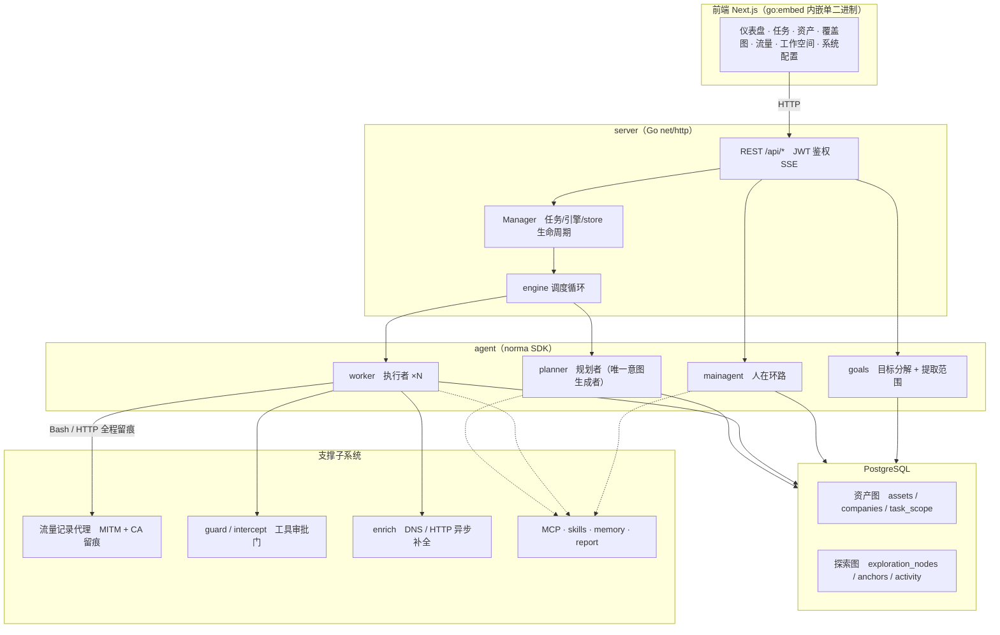
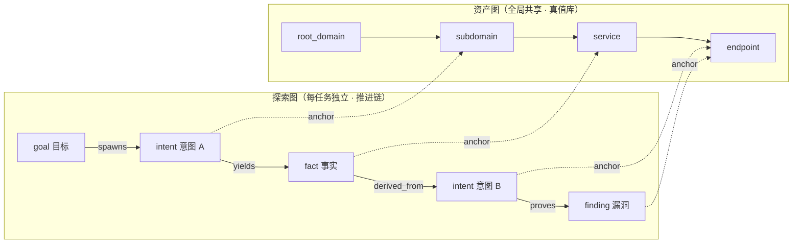
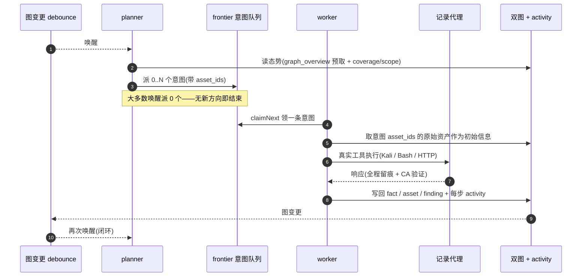
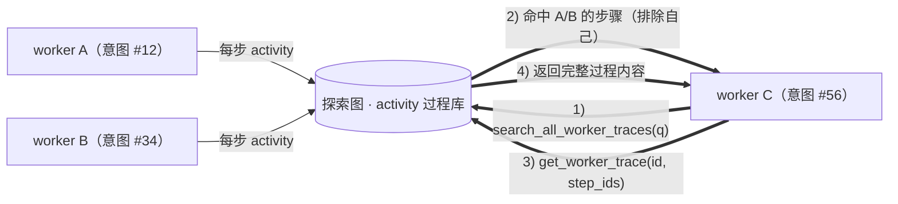
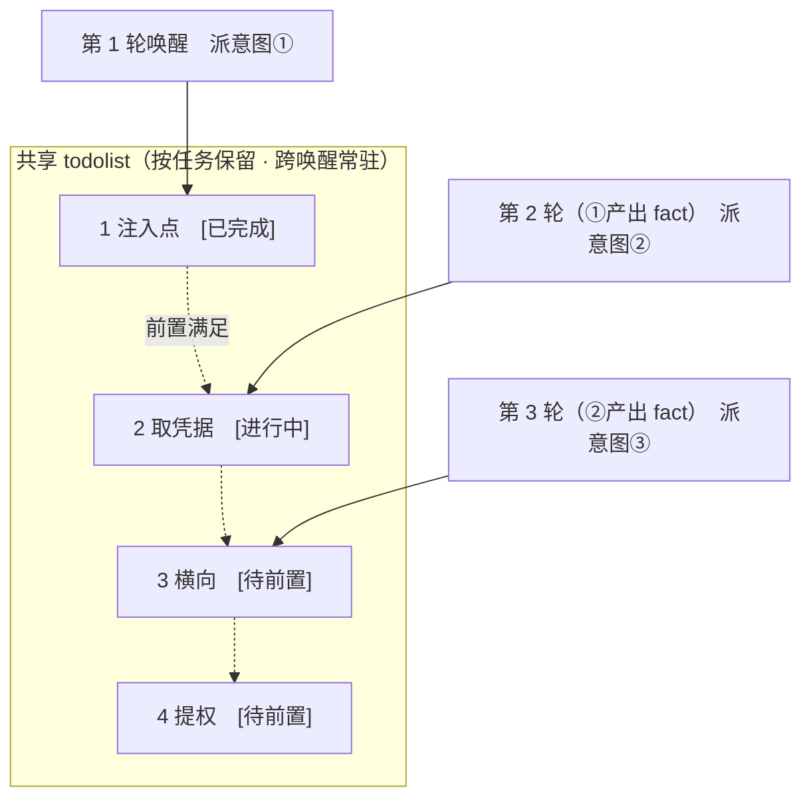

<div align="center">

# ARTEX

AI 자율 침투 테스트 시스템(Go 백엔드 + Next.js 프런트엔드)


**온라인 Demo(모의 데이터)**: [https://artex-demo.mhtsec.com](https://artex-demo.mhtsec.com)

**이 저장소는 ARTEX 마지막 버전의 소스 코드만 보관하는 백업입니다. 기존 Docker 이미지 소스 `autumn27/artex`는 더 이상 사용할 수 없으며, 현재 이 저장소에서 `mianhuatang11/artex` 이미지(Docker Hub)를 직접 유지 관리합니다. 이미지를 가져오지 못하면 `docker compose build`로 소스 코드에서 로컬 빌드할 수 있으며, 외부 사전 컴파일 산출물에 의존하지 않습니다.**

</div>

**언어:** [简体中文](README.md) | 한국어

---

## 스크린샷 미리보기

> 전체 상호작용은 [온라인 Demo](https://artex-demo.mhtsec.com)에서 확인할 수 있습니다(프런트엔드 + Mock 데이터만 사용하며, 백엔드가 필요하지 않습니다).

| 대시보드(개요 / Token 사용량 / 활동 스트림) | 작업 목록 |
| :---: | :---: |
|  |  |

| 작업 · 실행 과정(세션 / 도구 호출) | 탐색 경로 |
| :---: | :---: |
|  |  |

| 발견 항목 | 자산 |
| :---: | :---: |
|  |  |

| 자산 커버리지 그래프(힘 기반 레이아웃 · 테스트된 자산 강조 · 노드 접기 및 펼치기) |
| :---: |
|  |

| 트래픽 기록 | 사람 참여형 대화 |
| :---: | :---: |
|  |  |

| Agent 관리 | LLM 설정 |
| :---: | :---: |
|  |  |

| 차단 승인 | 백엔드 로그 |
| :---: | :---: |
|  |  |


---

## 승인 기록 상세

전역 "승인 기록", 작업 내 "차단 승인", 대화의 승인 카드는 모두 펼쳐서 상세 내용을 볼 수 있습니다. 표시 구조는
[AegisHook의 승인 상세 컴포넌트](https://github.com/RuoJi6/AegisHook/blob/main/web/src/components/CallDetail.vue)를 참고하며, ARTEX의 컴포넌트와 테마를 사용합니다.


## 자산 동기화(ScopeSentry)

[ScopeSentry](https://github.com/Autumn-27/ScopeSentry)에서 자산 데이터를 직접 동기화하여 중복 수집을 줄일 수 있습니다.

- "**자산 동기화**" 페이지에 ScopeSentry 주소와 API Key를 입력하여 데이터 소스를 연결합니다.
- **프로젝트** 또는 **작업** 단위로 동기화할 대상과 자산 유형(도메인 / 하위 도메인 / IP / 포트 / 사이트 / 엔드포인트 등)을 선택합니다.
- 한 번의 클릭으로 가져와 회사의 자산 범위에 따라 통합합니다. 자산은 바로 ARTEX 자산 그래프에 들어가 agent의 탐색에 사용됩니다.

---

## 설치

> **PostgreSQL** 데이터베이스가 필요합니다. 탐색하려면 **LLM**을 설정해야 합니다(`ANTHROPIC_API_KEY` 또는 `OPENAI_API_KEY`, UI에서도 설정 가능).

### 방법 1: 원클릭 설치 스크립트(권장)

```bash
git clone https://github.com/mhtsec/ARTEX.git
cd ARTEX
./install.sh
```

스크립트는 Docker를 감지하고 자동 설치한 뒤, **① 전체 Docker 실행** 또는 **② 로컬 빌드 및 실행**을 선택하게 합니다.

- **① 전체 Docker 실행**: Postgres 비밀번호를 입력합니다(Enter를 누르면 임의 생성). → `.env` 자동 작성 → `docker compose up -d`.
- **② 로컬 실행**: 데이터베이스를 선택합니다(기존 데이터베이스 연결 / Docker로 새로 실행). → `config.json` 생성 → `go`로 프런트엔드가 내장된 단일 바이너리 빌드 → 실행.

설치 후 **http://localhost:8787**을 엽니다(처음에는 `/setup`에서 관리자 비밀번호를 설정합니다).

### 방법 2: Docker Compose(수동)

```bash
git clone https://github.com/mhtsec/ARTEX.git
cd ARTEX
cp .env.example .env          # 填 POSTGRES_PASSWORD、可选 ANTHROPIC_API_KEY
docker compose up -d          # 拉取 mianhuatang11/artex 镜像 + postgres
# → http://localhost:8787
```

> 기존 이미지 소스 `autumn27/artex`는 Docker Hub에서 삭제되었으며, 현재 이 저장소가 **`mianhuatang11/artex`** 이미지를 직접 유지 관리합니다.
> 이미지 소스를 사용할 수 없거나 코드를 직접 수정하려면 소스 코드에서 로컬 빌드하면 됩니다: `docker compose build && docker compose up -d`.
> Dockerfile은 다단계 빌드(프런트엔드 정적 내보내기 → Go 정적 빌드 → 실행 이미지)이며, 기본적으로 중국 내 접근에 적합한 의존성 소스를 사용합니다. `--build-arg GOPROXY=... / --build-arg NPM_REGISTRY=...`로 재정의할 수 있습니다.

이미지에는 자주 사용하는 도구(ripgrep/curl/vim/npm/nmap 등)가 포함되어 있습니다. `./skills`와 `./data`는 바인드 마운트로 영속화됩니다.

원격 MCP는 시스템 설정에서 `http`(Streamable HTTP) 또는 `sse`(기존 SSE)를 선택할 수 있습니다.
기존 SSE 서비스는 보통 `GET /sse`로 이벤트 스트림을 연결하고, 서비스가 반환한
`/message?sessionId=...`로 JSON-RPC 요청을 받습니다. 설정 시 URL에는 `/sse`를 입력하고, 요청 헤더는
`Authorization=Bearer <token>` 형식으로 입력합니다.

### 방법 3: 사전 컴파일 바이너리 다운로드(Releases)

기존 저장소의 [Releases](https://github.com/Autumn-27/ARTEX/releases)에서 플랫폼에 맞는 zip을 다운로드합니다(**이 백업 저장소는 바이너리를 제공하지 않습니다.** 기존 Releases도 사용할 수 없으면 방법 2 또는 방법 4를 사용하세요). 압축을 풀면 `artex` + `start.sh`(Windows는 `start.bat`) + `skills/` + `config.example.json`이 나옵니다.

```bash
cp config.example.json config.json   # 填好 database 连接
./start.sh                           # → http://localhost:8787
```

> `start.sh` / `start.bat`로 시작하고, `./artex`를 직접 실행하지 마세요. 이 스크립트는 프로그램 종료 코드에 따라 다시 실행할지 결정하는 감시 스크립트입니다. **페이지의 [원클릭 업데이트](#방법-1-페이지-원클릭-업데이트권장)는 이 스크립트가 바이너리 교체를 마무리합니다.** `./artex`를 직접 실행하면 업데이트 후 다시 시작되지 않습니다.
> 백그라운드 실행: `nohup ./start.sh >artex.log 2>&1 &`.

### 방법 4: 소스에서 단일 바이너리 빌드

```bash
# 1) 前端静态导出
cd web && npm ci && npm run build:static && cd ..
# 2) 拷进内嵌目录
cp -r web/out server/webui/dist
# 3) 编译（-tags embedui 才内嵌前端）
CGO_ENABLED=0 go build -tags embedui -o artex ./cmd/artex
./start.sh
```

### 방법 5: 크로스 플랫폼 Release 압축 파일 빌드

`build.sh`는 먼저 프런트엔드를 빌드하여 내장하고, Go linker로 디버그 정보를 제거한 다음 배포 파일을 zip으로 압축합니다. Release 모드는 기본적으로 Linux amd64/arm64, macOS amd64/arm64, Windows amd64용 zip을 생성합니다.

```bash
./build.sh --release
# 产物：dist/artex-0.3.3-*.zip
```

UPX 자체 압축 해제 바이너리는 일부 Linux 커널, 가상화 환경 또는 보안 정책과 호환되지 않을 수 있으므로 기본적으로 활성화하지 않습니다. `ARTEX_TARGETS`로 대상을 지정할 수 있습니다. 대상 실행 환경과의 호환성을 확인했다면 `--upx`를 명시적으로 전달하여 바이너리 크기를 더 줄일 수 있습니다.

```bash
ARTEX_TARGETS=linux/amd64,windows/amd64 ./build.sh --release
./build.sh --target linux/amd64 --upx
```

---

## 업데이트 및 업그레이드

> 업그레이드는 프로그램만 교체하며 데이터를 변경하지 않습니다. Postgres 데이터 볼륨 `pgdata`, `./data`(jwt.key / SQLite 등), `./skills`는 보존됩니다. **데이터베이스 마이그레이션을 수동으로 실행할 필요가 없습니다.** `artex`가 시작할 때마다 `schema.sql`을 멱등적으로 다시 실행합니다(`ADD COLUMN` / `CREATE INDEX IF NOT EXISTS` 포함). 즉, 재시작하면 마이그레이션됩니다. 그래도 업그레이드 전에는 `./data`와 데이터베이스를 백업하는 것이 좋습니다.

### 방법 1: 페이지 원클릭 업데이트(권장)

**시스템 설정** 페이지(사이드바 "시스템 설정" → `/system/settings`)의 **버전 및 업데이트** 카드에서 서버에 로그인하지 않고 새 버전을 확인하고 설치할 수 있습니다.

"업데이트"를 누르면 현재 플랫폼의 배포 패키지를 다운로드하고 → Release의 `SHA256SUMS`와 대조하고 → `-h`로 새 바이너리를 스모크 테스트하고 → `artex.new`로 임시 저장한 뒤 → 프로그램을 종료합니다. `start.sh` / `start.bat`가 다시 실행하여 교체를 마무리합니다. 페이지는 새 버전이 온라인 상태가 될 때까지 자동으로 기다린 후 새로 고칩니다.

- **실패해도 잘못된 프로그램이 남지 않습니다**: 검증 또는 스모크 테스트가 실패하면 임시 파일을 버리고 현재 버전을 계속 실행합니다. 교체된 새 버전이 연속 3회 시작에 실패하면 `artex.old`로 자동 롤백합니다(실패한 바이너리는 문제 분석용 `artex.failed`로 남깁니다).
- **언제든 되돌릴 수 있습니다**: 이전 버전은 `artex.old`로 보관하며 카드에 "이전 버전으로 롤백"이 있습니다. 데이터베이스 구조는 되돌리지 않습니다.
- **업데이트는 실행 중인 작업을 중단합니다.** 업데이트는 재시작이므로 작업이 없는 시간에 수행하세요.
- **개발 빌드는 업데이트하지 않습니다**: 버전이 `dev`이거나 `git describe`에 접미사가 있으면 업데이트를 비활성화하여 정식 버전이 로컬 디버깅용 바이너리를 덮어쓰지 않게 합니다.
- **Docker에서는 프로그램만 교체하고 이미지는 교체하지 않습니다**: 이미지의 playwright / nmap 등 도구 체인은 업그레이드되지 않습니다. 또한 `docker compose up -d`로 컨테이너를 다시 만들면 이미지에 포함된 버전으로 돌아갑니다. 이미지까지 업그레이드하려면 `docker compose pull artex && docker compose up -d artex`를 사용하세요.
- GitHub 접근에 프록시가 필요하면 같은 페이지에서 **전역 프록시**를 설정하세요. 업데이트도 해당 프록시를 사용합니다. 업데이트 다운로드는 GitHub 도메인으로 한정되며 HTTPS를 강제합니다.

### 방법 2: 원클릭 업데이트 스크립트

```bash
cd ARTEX
./update.sh
```

스크립트는 먼저 선택적으로 `git pull`로 최신 코드를 가져온 뒤, **① Docker 업데이트** 또는 **② 로컬 빌드 업데이트**를 선택하게 합니다(`install.sh`의 선택지와 대응).

- **① Docker**: 대상 이미지 tag를 지정할 수 있습니다(Enter를 누르면 `.env`의 `ARTEX_TAG`를 사용하며, 기본값은 `latest`). → `docker compose pull` → `docker compose up -d`(새 이미지로 재시작하면 자동 마이그레이션).
- **② 로컬**: 프런트엔드 정적 산출물을 다시 빌드하고 → `./artex`를 다시 컴파일합니다(완료 후 프로세스를 재시작해야 적용됨).

### 방법 3: Docker Compose(수동)

```bash
cd ARTEX
git pull                       # 更新 compose / 脚本（可选）
# 指定版本：在 .env 设 ARTEX_TAG=v0.2.0；不设则用 latest
docker compose pull artex
docker compose up -d artex     # 换新镜像重启 → 自动迁移 schema
docker image prune -f          # 清理旧镜像（可选）
```

### 방법 4: 사전 컴파일 바이너리(Releases)

[Releases](https://github.com/Autumn-27/ARTEX/releases)에서 새 버전 zip을 다운로드합니다. 기존 프로세스를 중지한 뒤 `artex`와 `skills/`를 덮어쓰고(`config.json`과 `data/`는 보존), 다시 시작하면 됩니다.

```bash
cp -r <解压目录>/skills ./ && cp <解压目录>/artex ./
./start.sh
```

### 방법 5: 소스에서 빌드

```bash
git pull
cd web && npm ci && npm run build:static && cd ..
cp -r web/out server/webui/dist
CGO_ENABLED=0 go build -tags embedui -o artex ./cmd/artex
# 重启 ./start.sh
```

---

## 설정

**데이터베이스**(`config.json`, 또는 환경 변수 `ARTEX_PG_DSN`으로 재정의):

```json
{
  "database": {
    "host": "127.0.0.1", "port": 5432,
    "user": "artex", "password": "yourpass",
    "dbname": "artex", "sslmode": "disable"
  }
}
```

**LLM**: `export ANTHROPIC_API_KEY=sk-...`(또는 `OPENAI_API_KEY`). UI의 "LLM 설정" 페이지에서도 입력할 수 있습니다.
선택 사항: `ARTEX_LLM_PROVIDER` / `ARTEX_LLM_MODEL` / `ARTEX_LLM_BASE_URL` / `ARTEX_LLM_PROXY`.

**동시 실행**: 작업별 work agent 수는 "시스템 설정"에서 설정합니다(기본값 3).

**자주 사용하는 인수**: `./start.sh -addr :8787 -proxy :8788`(`-addr`는 프런트엔드+API, `-proxy`는 트래픽 기록 프록시). 시작 스크립트는 인수를 그대로 `artex`에 전달합니다.

### 리버스 프록시 배포(HTTPS / 443만 공개)

프런트엔드와 API/SSE는 같은 백엔드 포트(기본값 `:8787`)에서 제공됩니다. 실시간 활동 스트림은 기본적으로 **동일 출처** 주소를 사용하므로 **`NEXT_PUBLIC_SSE_BASE`를 설정할 필요가 없습니다.** 외부에는 443만 공개하고 8787은 내부 네트워크에 두면 됩니다.

SSE는 장기 연결로 계속 데이터를 푸시하므로 리버스 프록시는 **버퍼링을 반드시 꺼야 합니다.** 그렇지 않으면 브라우저가 연결되어도 이벤트를 받지 못합니다(활동 스트림의 로딩 표시가 계속 돌아감). Nginx 예시:

```nginx
server {
    listen 443 ssl;
    server_name your.domain.com;
    # ssl_certificate / ssl_certificate_key ...

    location / {
        proxy_pass http://127.0.0.1:8787;
        proxy_set_header Host $host;
        proxy_set_header X-Forwarded-Proto $scheme;

        # SSE 关键项：关缓冲、长超时、HTTP/1.1
        proxy_buffering off;
        proxy_cache off;
        proxy_read_timeout 3600s;
        proxy_http_version 1.1;
        proxy_set_header Connection "";
    }
}
```

> SSE가 페이지와 다른 출처(예: 별도의 하위 도메인)를 사용해야 할 때만 **빌드 시점**에 `NEXT_PUBLIC_SSE_BASE`를 설정하세요. 이 변수는 `next build` 시 정적 패키지에 고정되므로 컨테이너 실행 시 설정해도 적용되지 않습니다.

---


## 개발

### 수동 취약점 재테스트

작업 상세의 "재테스트" 탭에서 이 작업의 취약점을 페이지별로 선택하고, 과거 결론과 증거를 확인하며, 수동으로 재테스트를 시작할 수 있습니다. 시작 후에도 현재 탭을 유지하고 회전 아이콘과 "재테스트 중"을 표시합니다. 수정이 확인되면 취약점 상태도 함께 업데이트합니다.

취약점 목록의 각 행 작업 영역에서 "재테스트"를 누르거나 취약점 상세의 "취약점 재테스트" 영역에서 "재테스트 시작"을 누른 뒤, 선택적으로 수정 버전, 테스트 조건 또는 제한을 입력합니다. 시스템은 독립 재테스트 Agent 세션을 생성하며 시작 후에도 현재 페이지를 유지합니다. 평면 목록, 작업별 그룹 목록, 자산 보기 모두 이 진입점을 지원합니다. 재테스트 중에는 회전 아이콘과 "재테스트 중"을 표시하고, 확인이 필요하면 눌러 해당 세션으로 이동합니다. 완료하면 "재테스트"로 돌아옵니다. 원래 스캔 작업을 다시 시작할 필요는 없습니다. 결론은 "여전히 재현 가능", "수정됨", "확인 불가"로 나뉘며, 매번 결론, 증거 및 세션 링크를 취약점 상세에 저장합니다.

새 백엔드를 처음 시작하면 편집 가능한 "취약점 재테스트"(`retester`) Agent가 미리 생성됩니다. Agent 관리에서 프롬프트, LLM, 실행 예산 및 도구를 설정할 수 있습니다. 기본적으로 연결된 LLM을 사용하며 연결된 LLM이 없으면 전역 활성 설정을 사용합니다. 재테스트 세션이 성공적으로 완료되고 결론이 "수정됨"이면 취약점 처리 상태를 자동으로 "수정됨"으로 바꿉니다. 실행 중, 실패, 중지 또는 다른 결론일 때는 기존 상태를 유지합니다. 원본 증거와 보고서는 항상 보존합니다. 상태 드롭다운에서 "수정됨"을 수동으로 선택할 수도 있습니다. 같은 취약점을 재테스트 중이면 기존 세션을 재사용하며, 중지, 실패 또는 서비스 재시작 후에는 다시 시작할 수 있습니다.

이 버전의 이력은 취약점 상세와 세션에서 확인합니다. 아직 취약점 보고서 내보내기나 작업 아카이브 패키지에는 포함되지 않으며, 트래픽 패키지와 자동으로 연결되지도 않습니다. 데모 모드는 모의 기록임을 명확하게 표시한 기록만 생성하며 실제 대상에 요청하지 않습니다.

### 로컬 실행 및 테스트

```bash
./dev.sh    # 后端(:8787) + 流量代理(:8788) + 前端 next dev(:5173) → http://localhost:5173
```

- 백엔드: `go run ./cmd/artex`(`-tags embedui`가 없으면 프런트엔드를 내장하지 않음)
- 프런트엔드: `cd web && npm run dev`(`/api`는 백엔드로 리버스 프록시되며 핫 리로드 지원)
- 테스트: `go test ./...`
- Mock 미리보기(백엔드 없음): `cd web && NEXT_PUBLIC_MOCK=1 npm run dev`
- 온라인 Demo 재배포(Cloudflare Pages, 정적 내보내기 + Mock 데이터):
  ```bash
  cd web && NEXT_PUBLIC_MOCK=1 npm run build:static
  CLOUDFLARE_API_TOKEN=<token> npx wrangler pages deploy out --project-name=artex-demo --branch=main
  ```

---

## 시스템 기술 아키텍처

ARTEX는 **LLM 다중 agent 기반의 자율 침투 시스템**입니다. Go 단일 백엔드(Next.js 프런트엔드 내장) + PostgreSQL로 구성되며, agent 기능은 [`norma`](https://github.com/Autumn-27/norma) SDK가 제공합니다(`agentcore` / `tool` / `permission` / `harness` / `memory` / `transcript`). 핵심은 **이중 그래프 아키텍처**와 이를 중심으로 한 두 가지 자율 동작 메커니즘, 즉 **worker 간 실행 과정 단위 정보 교환**과 **planner의 여러 라운드 공유 todolist를 통한 안정적인 공격 경로**입니다.

### 전체 계층



| 계층 | 책임 |
| --- | --- |
| **프런트엔드** | Next.js 정적 내보내기를 `go:embed`로 단일 바이너리에 내장. 작업/자산/탐색 경로/커버리지 그래프 시각화 및 사람 참여형 대화 |
| **server** | `net/http` 라우팅 + JWT 인증 + SSE. `Manager`가 작업, 엔진 및 DB store의 수명 주기를 관리 |
| **engine** | 작업마다 `plannerLoop` 하나와 N개의 worker goroutine. 의도 가져오기, 시간 초과/일시 중지/drain 처리 |
| **agent** | goals / planner / worker / mainagent. `ToolSet`이 두 그래프를 LLM 도구로 노출 |
| **db** | Postgres에 두 그래프 저장(pgx). `go:embed`로 내장된 schema를 시작할 때마다 멱등적으로 적용하여 테이블 생성 |
| **지원** | 기록형 MITM 프록시, 승인 게이트, 비동기 정보 보완, MCP/스킬/메모리/보고서 |

### 이중 그래프 아키텍처: 탐색 그래프 + 자산 그래프

시스템은 "**대상이 무엇인가**"와 "**어느 정도 테스트했는가**"를 서로 독립적이면서 앵커로 연결된 두 그래프로 나눕니다.

- **자산 그래프(Asset Graph, 전역 공유)**: 여러 작업이 공유하는 자산의 기준 정보 저장소입니다. 노드는 `root_domain / subdomain / ip / service / app / endpoint`이며 회사에 귀속됩니다. 도메인→하위 도메인→서비스→엔드포인트의 부모-자식 관계와 중복 제거 key는 모두 프로그램이 계산하고, agent는 원시 정보만 제출합니다.
- **탐색 그래프(Exploration Graph, 작업별 독립)**: 한 작업의 "사고와 진행" 과정입니다. 노드는 `goal（目标）/ intent（意图）/ fact（事实）/ finding（漏洞）/ hint（提示）`이며, `spawns / derived_from / yields / proves` 등의 간선으로 **계보 체인**을 형성하여 "어떤 방향이 어떤 사실에서 파생되었고 무엇을 만들어 냈는가"를 보여 줍니다.
- **두 그래프는 앵커로 연결됩니다**: `exploration_anchors(node_id, asset_id)`가 의도/사실/취약점을 구체적인 자산에 고정합니다. 따라서 "탐색 방향"에서 대상 자산을 볼 수 있고, "특정 자산"에서 이 작업의 어떤 의도가 테스트했으며 어떤 사실을 얻었는지 역으로 조회할 수 있습니다. 이는 **자산 테스트 커버리지**와 **자산 커버리지 그래프**(범위 내 자산 + 테스트된 자산 강조)도 뒷받침합니다.



> 역할 분담: **planner**는 탐색 그래프의 현황을 읽고 목표를 판단하며, 아직 다루지 않은 새 방향이 있을 때만 **의도**를 frontier에 넣습니다. **worker**는 **의도 하나**를 가져와 실제 도구로 실행하고 새 자산/사실/취약점을 두 그래프에 기록한 뒤 종료합니다. 자산 그래프는 공유 사실이고, 탐색 그래프는 작업별 진행 체인입니다.

### 엔진과 의도 수명 주기(탐색 한 회차의 폐루프)

엔진은 **이벤트 기반** 폐루프입니다. 그래프가 바뀌면 planner를 깨우고, planner가 의도를 배정하며, worker가 의도를 가져와 실행하고 결과를 기록합니다. 기록은 다시 다음 라운드를 트리거하며, 목표가 증명될 때까지 반복합니다(`prove_goal`).



### worker 간 실행 과정 단위 정보 교환

깊이 있는 탐색에서는 가치 있는 관찰(특정 오류, 응답 일부, 숨겨진 매개변수 등)이 worker의 **실행 과정**에서 나오지만 정식 fact로 기록되지 않을 수도 있습니다. 중복 작업을 피하고 경로상의 worker가 서로의 결과를 활용할 수 있도록, worker는 **다른 work의 실행 과정을 검색**할 수 있습니다.

- `search_all_worker_traces(q)`: **이 작업의 다른 work 실행 과정**을 키워드로 검색합니다(자신이 맡은 의도의 단계는 자동 제외). 검색 결과에는 `intent_id`가 포함됩니다.
- `list_worker_traces` / `get_worker_trace(intent_id, step_ids=[…])`: 먼저 어떤 work가 실행되었는지 확인하고, 특정 work의 구체적인 몇 단계 전체 내용을 가져와 상세 정보를 교환합니다.

따라서 탐색 그래프에 해당 fact가 아직 없어도 후속 worker가 다른 worker의 실행 과정에서 얻은 관찰을 재사용할 수 있습니다. **정보는 worker 사이에서 "실행 과정" 단위로 흐르며**, 역할 경계는 바뀌지 않습니다(각 worker는 여전히 자신이 가져온 의도 하나만 수행).



### planner의 여러 라운드 공유 todolist → 안정적인 공격 체인

실제 공격 체인은 흔히 **앞뒤 의존성이 있는 여러 단계의 순서**입니다(예: 주입 지점 발견 → 자격 증명 확보 → 횡적 이동 → 권한 상승). 한 번에 모두 병렬 배정하면 순서가 흐트러집니다. 그래서 planner는 **작업별로 보존하고 여러 차례의 깨어남에 걸쳐 공유하는 계획 할 일 목록(todolist)**을 유지합니다.

- planner는 이벤트 기반이므로 그래프가 바뀌면 깨어나지만, **깨어날 때마다 새 세션**을 사용합니다. 공유 todolist를 통해 순차적 익스플로잇 체인을 **한 번 기록**한 뒤 후속 라운드에서 **의존성에 따라 단계적으로 의도를 배정**합니다. 한 라운드에 전체 체인을 미리 모두 펼쳐 놓지 않습니다.
- 각 라운드에서는 "선행 단계가 완료되었고 필요한 fact가 이미 존재하는" 다음 단계만 의도로 배정하며, 진행에 따라 목록을 업데이트합니다(fact로 충족된 단계를 완료 표시).



따라서 "이벤트 기반 + 상태 없는 세션" 환경에서도 공격 체인이 **안정적으로 진행되며 중복되거나 순서가 뒤바뀌지 않습니다.** 이것이 ARTEX가 여러 단계의 익스플로잇 체인을 자율적으로 끝까지 수행하는 핵심입니다.

---

## 커뮤니티

QR 코드를 스캔하여 WeChat 공식 계정 **SecSentry**를 팔로우한 뒤 계정에 메시지를 보내면 교류 그룹에 참여할 수 있습니다.

<div align="center">


</div>

---
## 참고

https://github.com/oritera/Cairn

한국어 사용자 참고 문서: [취약점의 다중 트래픽 증거](docs/ko-KR/traffic-evidence.md) · [ARTEX /btw 안내](sidequestion/README.ko-KR.md).


## 라이선스 및 면책 조항

### 오픈 소스 라이선스

이 프로젝트는 **GNU Affero General Public License v3.0(AGPL-3.0)**으로 배포합니다. 전체 조항은 저장소 루트의 [LICENSE](LICENSE) 파일을 참고하세요.

누구나 이 프로젝트를 자유롭게 사용, 수정 및 배포할 수 있지만, **파생 저작물도 AGPL-3.0으로 소스를 공개해야 합니다.** 특히 **이 프로젝트를 수정하여 네트워크로 사용자에게 제공하는 경우(예: 온라인 서비스 배포), 해당 사용자에게 대응하는 전체 소스 코드를 공개해야 합니다.**

> **중요 안내**: 오픈 소스 라이선스 자체는 소프트웨어의 사용 목적을 제한하지 않습니다. 아래 "사용 제한" 및 "면책 조항"은 사용자를 대상으로 한 작성자의 추가 약정과 엄중한 선언입니다. 반드시 준수하세요.

**ARTEX는 개인 학습, 코드 연구 및 로컬 기술 검증만을 위한 도구이며, 어떠한 온라인 시스템이나 웹사이트에도 실제 테스트를 수행하는 데 사용할 수 없습니다.**

### 허용되는 사용 범위

- **이 프로젝트의 소스 코드 읽기, 학습 및 연구**, 그리고 **로컬 격리 환경**에서의 기술 원리 검증에만 사용할 수 있습니다.
- 개인 학습, 학술 연구, 코드 검토 등 비공격적 목적에 적합합니다.

### 금지 사항

- **이 도구로 어떠한 웹사이트, 온라인 서비스 또는 네트워크에 연결된 시스템을 스캔, 탐지, 익스플로잇 또는 공격하는 행위를 엄격히 금지합니다**(허가 여부 또는 소유 자산 여부와 무관).
- 이 도구를 실제 침투 테스트, 공격·방어 대결 또는 운영 환경에 사용하는 것을 엄격히 금지합니다.
- 이 도구를 불법 침입, 데이터 탈취, 갈취, 서비스 거부 또는 기타 파괴적·범죄적 활동에 사용하는 것을 엄격히 금지합니다.
- 이 도구로 거주 국가/지역의 법률과 규정을 위반하는 행위를 엄격히 금지합니다.

### 규정 준수 책임

사용자는 거주 국가/지역의 사이버 보안, 데이터 보호 및 컴퓨터 범죄에 관한 모든 법률과 규정을 스스로 준수해야 합니다(중국 본토에서는 사이버보안법, 데이터안전법, 개인정보보호법 및 관련 사법 해석 등을 포함하되 이에 한정하지 않음). **이 도구 사용으로 발생하는 모든 법적 책임과 결과는 사용자가 부담합니다.**

### 면책 조항

이 프로젝트는 "현 상태(AS IS)"로 제공하며 어떠한 명시적 또는 묵시적 보증도 하지 않습니다. 작성자와 기여자는 사용 방식의 적절성 여부와 관계없이 이 도구 사용으로 발생하는 직접적·간접적 손실, 데이터 손실, 시스템 손상 또는 법적 분쟁에 대해 책임지지 않습니다. **이 프로젝트를 다운로드, 설치 또는 사용하면 위의 모든 조항을 읽고 이해했으며 동의한 것으로 간주합니다.**
