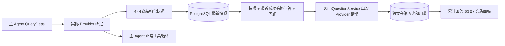

# ARTEX `/btw`

**언어:** [简体中文](README.md) | 한국어

일반 채팅, 작업 MainAgent 및 현재 작업 자체의 Worker는 독립적인 사이드 질문을 지원합니다. 주 입력창에 `/btw 问题` 형식으로 질문을 입력하면 제출할 수 있습니다. 내용 없이 `/btw`만 입력하거나 "사이드 질문" 버튼을 누르면 이력을 엽니다. 데스크톱에서는 너비를 조절할 수 있는 사이드바를, 모바일에서는 Drawer를 사용합니다.

사이드 답변은 제출 시점의 Agent 컨텍스트 스냅샷을 바탕으로 생성하며, 스트리밍 표시, 후속 질문, 중지 및 비우기를 지원합니다. 패널을 닫거나 페이지를 새로 고치거나 SSE 연결을 끊어도 모델 요청은 취소되지 않습니다. 중지는 현재 사이드 요청에만 영향을 줍니다. 비우기는 사이드 요청을 취소하고 사이드 질문 이력을 삭제하지만 주 컨텍스트 스냅샷은 유지합니다.

## 구현 범위

원문에 기록된 구현은 Go, norma v0.3.7, Next.js 및 기존 Markdown / ResizablePanel / Drawer / AlertDialog 컴포넌트를 사용합니다. norma 소스 코드를 수정하거나 사이드 질문용 의존성을 추가하지 않았습니다. Planner, 다른 작업에서 상속한 Worker 및 도구형 하위 작업의 확장은 이 구현의 범위에 포함되지 않습니다.

- `capture.go`는 `Options.Deps.CallModel / CallModelSync`에서만 주 루프 요청을 표시합니다. Provider 데코레이터는 구체적인 모델 내부, 라우팅 풀의 외부 선택 이후에 위치하므로 실제 선택된 모델을 기록합니다. 압축 및 요약 요청은 스냅샷을 덮어쓰지 않습니다.
- 요청 시작, 완전한 모델 응답 및 실행 최종 상태에서 스냅샷을 게시합니다. 생성 중인 일부 응답은 게시하지 않습니다. 도구 호출은 norma의 `MessagesForAPI`로 짝을 유지하며, 도구 결과는 다음 주 모델 요청 또는 실행 최종 상태에서 스냅샷에 포함됩니다. 스트리밍이 중단되면 직전의 유효한 경계를 보존합니다.
- 스냅샷은 JSON 깊은 복사로 구조화된 메시지, 시스템 프롬프트, 도구 정의 및 생성 매개변수를 보존합니다. 모델 추론 중에는 스냅샷 잠금이나 데이터베이스 트랜잭션을 유지하지 않습니다.
- `SideQuestionService`는 구체적인 Provider를 호출합니다. 필요하면 먼저 사이드 질문 요약을 생성합니다. 최종 답변은 처음 컨텍스트 한도를 초과했고 아직 텍스트/도구 호출을 출력하지 않은 경우에만 축소 후 한 번 재시도할 수 있습니다. agent session을 생성하지 않고, 도구 실행기, 주 transcript, 활동 스트림 또는 작업 그래프에 연결하지 않으며, 작업 모델 전환 체인도 거치지 않습니다. 답변 요청에 도구 정의를 유지하는 이유는 기존 구조화된 도구 컨텍스트와의 호환성입니다. 요약 요청에는 도구를 제공하지 않습니다. 새로 반환된 도구 호출에는 실행 경로가 없습니다.
- 부모 세션마다 요청 하나만 실행하며, 단일 서비스 프로세스에서는 최대 네 개까지 실행합니다. 요청 하나의 시간 제한은 120초입니다. 사이드 질문은 서비스 수명 주기에 속하는 독립 취소 컨텍스트를 사용합니다.
- 사이드 요청은 모델 설정 참조와 민감하지 않은 식별 요약을 보존하며, 요청 시 기존 설정에서 자격 증명을 가져옵니다. 설정이 삭제되거나 모델, 프로토콜, 주소 등의 식별 필드가 바뀌면 먼저 주 Agent를 실행하여 스냅샷을 업데이트해야 합니다. 테스트는 제품의 기본 모델을 바꾸지 않습니다.

## 영속화 및 복구

`db/schema.sql`은 `side_question_sessions`와 `side_question_requests`를 자동 생성합니다. 전자는 부모 리소스, 최신 스냅샷, 실행 번호, 버전 및 정리 버전을 저장하고, 후자는 질문, 누적 답변, 상태, 모델, 스냅샷 시각, 사용량, 이벤트 순번 및 페이지 순번을 저장합니다.

부모 세션 키는 conversation ID 또는 task ID + exploration ID + intent ID를 사용합니다. Worker에는 재사용 가능한 실행 슬롯의 이름을 사용하지 않습니다.

스냅샷은 부모 세션별로 병합하여 250 ms마다 저장합니다. 데이터베이스는 `(run_id, version)`을 비교하여 이전 버전이 덮어쓰지 못하게 합니다. 사이드 질문 제출 전에 선택된 스냅샷을 다시 저장합니다. 저장에 성공하면 메모리의 큰 스냅샷을 해제하고, 실패하면 저장 대기 버전을 유지합니다. 답변의 누적 내용은 스트리밍 이벤트 도착 시 최대 250 ms에 한 번 저장합니다. 최종 상태는 즉시 저장하며 데이터베이스 오류가 나면 제한된 횟수만 재시도합니다.

서비스가 시작되면 남아 있는 `running` 요청을 `interrupted`로 표시하고, 이미 데이터베이스에 저장된 부분 답변과 사용량을 보존합니다. 요청을 자동으로 다시 실행하지는 않습니다. 최근 성공적으로 저장된 컨텍스트는 다음 질문에 바로 사용할 수 있습니다. 기존 세션에 스냅샷이 없으면 주 Agent를 먼저 실행해야 하며, UI 활동 기록에서 컨텍스트를 재구성하지 않습니다.

비우기는 정리 버전을 증가시키고 요청을 삭제합니다. 조건부 업데이트는 늦게 도착한 콜백이 데이터를 다시 쓰지 못하게 합니다. 물리적인 부모 리소스 삭제는 외래 키의 연쇄 삭제를 사용합니다. Worker의 논리적 삭제는 같은 트랜잭션에서 사이드 질문 데이터를 삭제하고, 이후 늦게 도착한 스냅샷을 거부합니다. 작업 아카이브는 먼저 새 요청을 막고, 주 흐름이 멈출 때까지 기다린 뒤 사이드 요청을 취소하고 저장이 완료될 때까지 기다립니다. 아카이브 형식은 v3이며 사이드 질문 테이블이 없는 v1/v2도 호환됩니다.

이력은 모두 보존하며 순번 커서 기준으로 페이지당 최대 20개를 반환합니다. 모델 요청은 최근 성공한 질문·답변 최대 20쌍의 원문을 재사용하되 token 예산으로 재사용량을 제한합니다. 더 오래된 질문·답변은 별도의 누적 요약으로 관리합니다. 주 컨텍스트가 예산을 넘으면 사이드 질문용 복사본의 오래된 부분만 요약하고, 최근의 구조화된 도구 호출과 결과는 유지합니다. 요약, 준비 진행 상황 및 사용량도 사이드 질문의 동시 실행, 취소 및 120초 시간 제한에 포함됩니다. 자세한 내용은 [컨텍스트 예산 및 오픈 소스 참고(중국어 원문)](CONTEXT_BUDGET.md)를 확인하세요.

## HTTP 계약

다음 경로를 `{parent}`로 사용하며 기존 인증 및 리소스 검사를 그대로 적용합니다.

- `/api/conversations/{id}`
- `/api/tasks/{id}/chat`
- `/api/tasks/{id}/intents/{iid}`

| 요청 | 반환값 및 동작 |
| --- | --- |
| `GET {parent}/side-questions?before={ordinal}` | `items`는 최신순, 독립 `current` 실행 상태, `snapshot` 메타정보, `next_cursor`. 커서 0은 최신 페이지 / 다음 페이지 없음을 의미 |
| `POST {parent}/side-questions` | JSON `{ "question": "…", "client_request_id": "UUID" }`. 새 요청은 202 및 요청 객체를 반환하고, 같은 ID와 질문은 기존 객체와 200을 반환 |
| `DELETE {parent}/side-questions` | 현재 부모 세션의 사이드 질문·답변을 취소하고 비우기 |
| `GET /api/side-questions/{requestID}/events` | `snapshot` SSE 이벤트. `id`는 증가하는 순번이며 `data`는 전체 누적 요청 객체. 비우면 `cleared` 전송 |
| `POST /api/side-questions/{requestID}/cancel` | 명시적 취소. 최종 상태는 이력 또는 SSE에서 조회 가능 |

질문은 최대 4000자입니다. 스냅샷 없음, 모델 설정 변경, 같은 부모 세션 사용 중 또는 멱등 ID 충돌은 409를 반환하고, 전역 동시 실행 한도 초과는 429를 반환합니다. SSE는 연결할 때마다 누적 상태를 먼저 보내며 클라이언트가 전에 받은 텍스트 조각에 의존하지 않습니다. 프런트엔드는 요청 ID + 순번으로 병합하며 부모 세션 전환 및 비우기 시 이전 콜백을 폐기합니다.

## 검증 및 참고

자동화 검사, 실제 모델 사용 및 알려진 제한은 [VALIDATION.md(중국어 원문)](VALIDATION.md)를 참고하세요.

독립 요청은 [Grok CLI side-question.ts(고정 커밋)](https://github.com/superagent-ai/grok-cli/blob/fb97af83f06dca873281d60168430f06c8de6324/src/utils/side-question.ts)를 참고하고, 실행 격리는 [OpenCode(고정 커밋)](https://github.com/anomalyco/opencode/tree/b3f1a96c6dd7adeb28b36dd11add1998fc84d67b)를 참고합니다. ARTEX 컨텍스트는 norma의 구조화된 메시지를 사용하며 프런트엔드 로그를 이어 붙여 텍스트를 만드는 방식을 사용하지 않습니다.
